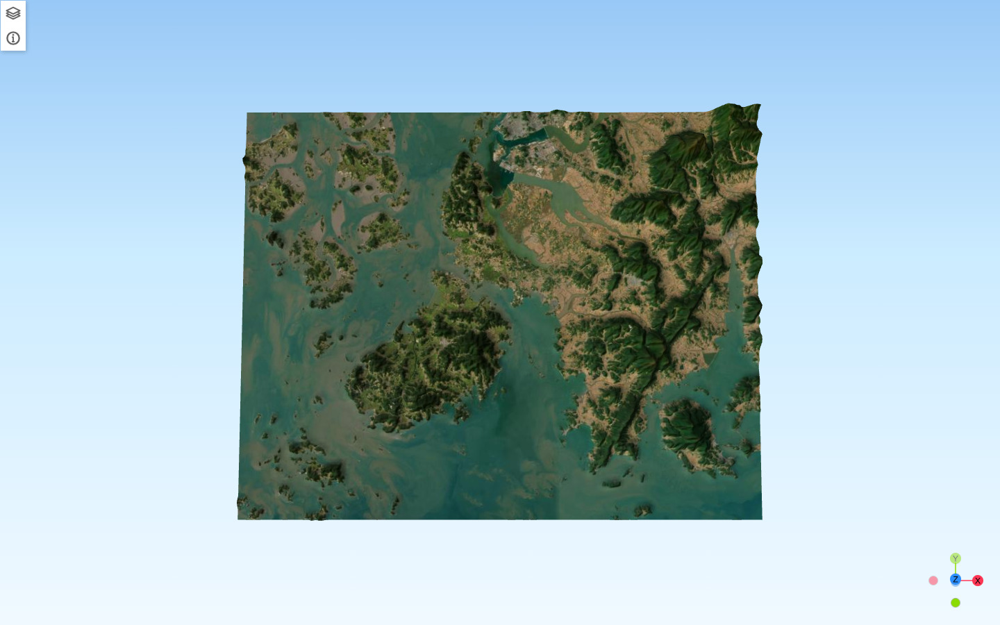

# 명량해전 3D 지형 (2026hackathon)

명량해전이 벌어진 울돌목 일대(진도와 해남, 목포 앞바다)의 땅 모양을 웹 브라우저에서 돌려 보는 3D 지형 모형입니다. 2026년 해커톤 자료로 올린 저장소이며, 지금은 이 지형 모형 하나만 들어 있습니다. 수업에서 좁은 물길과 섬, 산줄기가 어떻게 놓였는지 입체로 보여 줄 때 씁니다.

바로가기: https://yhk1m.github.io/2026hackathon/myeongryang/



## 할 수 있는 일

- **돌려 보기**: 마우스 왼쪽 단추를 누른 채 끌면 돌아가고, 바퀴로 당기거나 밀고, 오른쪽 단추로 옮깁니다. 처음 열면 지형이 작게 보이니 바퀴로 당겨서 봅니다.
- **키보드**: 화살표로 옮기고, Shift와 화살표로 돌립니다. `R`은 자동 회전, `W`는 뼈대(와이어프레임) 보기, `Shift+R`은 처음 자리로, `Shift+S`는 그림 저장입니다.
- **좌표 보기**: 지형을 누르면 그 자리의 좌표가 나오고, 두 점 사이 거리를 잴 수 있습니다.
- **레이어 창과 정보 창**: 왼쪽 위 단추로 엽니다. 정보 창에는 지금 보는 자리를 담은 주소가 나와 그대로 나눠 줄 수 있습니다.

## 만든 방법

- QGIS에서 SRTM 1초(약 30m) 수치 고도 자료(DEM) 위에 지도 그림을 입히고, Qgis2threejs 플러그인(2.10.2)으로 내보냈습니다.
- 높이는 실제보다 15배 키워서 낮은 산과 좁은 물길이 잘 보이게 했습니다.
- 지형 그림과 높이는 `data/myeongryang/scene.js` 한 파일에 들어 있어, 서버 없이 정적 파일로 열립니다.

## 실행하기

빌드할 것이 없습니다. GitHub Pages가 `main` 가지의 파일을 그대로 올립니다.

내 컴퓨터에서 열 때는 저장소 폴더에서 간단한 웹 서버를 띄우고 `myeongryang/` 주소를 엽니다.

```
python -m http.server 8000
# http://localhost:8000/myeongryang/
```

## 파일 구성

```
myeongryang/
  index.html                  3D 보기 화면
  data/myeongryang/scene.js   지형 높이와 지도 그림 (Qgis2threejs가 만든 자료)
  Qgis2threejs.js, .css, .png 보기 화면 코드와 모양
  threejs/                    three.js, OrbitControls, ViewHelper (MIT 라이선스, LICENSE 포함)
```

## 자료 출처

- 높이 자료: NASA SRTM 1 Arc-Second Global(SRTMGL1)
- 3D 내보내기: QGIS와 Qgis2threejs 플러그인(https://github.com/minorua/Qgis2threejs)
- 3D 그리기: three.js (MIT 라이선스, `myeongryang/threejs/LICENSE`)

## 만든 사람

양정고등학교 지리교사 김용현  
문의: bgnlkim@gmail.com
